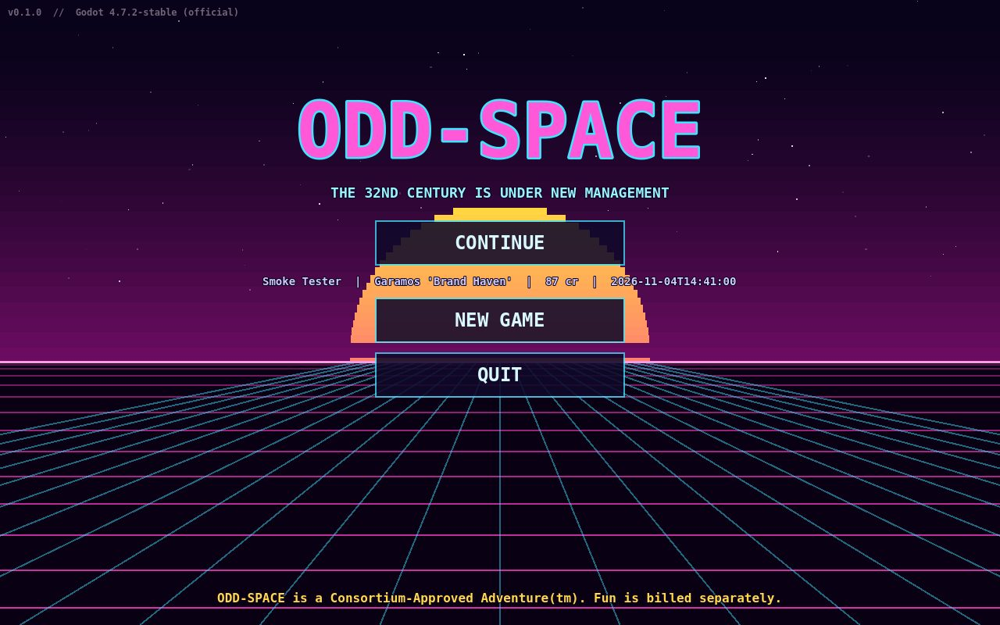
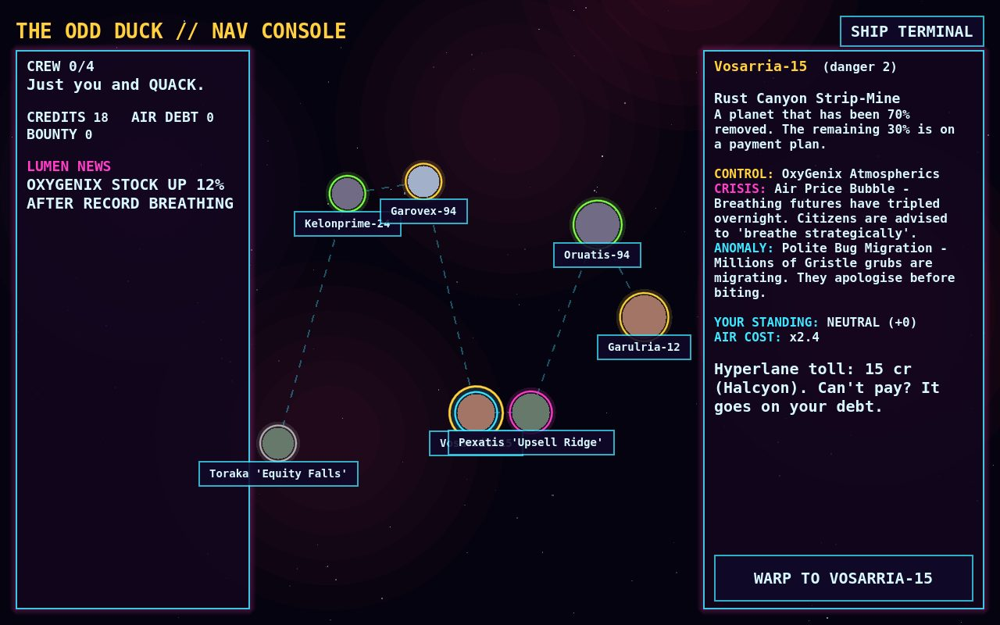

# ODD-SPACE

> **Sci-Fi HD-2D Action-RPG** · Retro-Futurism ยุค 80s/90s · Dark Satire เสียดสีทุนนิยมอวกาศ
> พัฒนาด้วย **Godot 4.7** (Mobile renderer / Vulkan) ออกแบบให้ทำงานบน **Samsung Galaxy Tab S12 Ultra** ได้ 100%


ศตวรรษที่ 32 · กลุ่มทุนบิ๊ก 5 **The Consortium** เก็บเงินกับทุกอย่าง แม้แต่อากาศหายใจ
คุณตื่นจากตู้แช่แข็งบนสถานีร้าง *Cold Storage Lot 47* พร้อมยานมือสอง **The Odd Duck**
และ AI ประจำยานปากแจ๋ว **Q.U.A.C.K.** (Quasi-Unlicensed Autonomous Cognitive Kernel)

| | |
|---|---|
|  |  |
|  |  |

*(ภาพ placeholder ทั้งหมดสร้างด้วยโค้ด — แทนที่ด้วยงานภาพจริงได้ทันทีโดยใช้ชื่อไฟล์/เลย์เอาต์เดิม)*

---

## สถานะตอนนี้ (v0.1.0 — Vertical Slice)

เล่นได้ครบลูป: **สร้างตัวละคร → ตื่นในสถานี → สู้/ขโมย/ติดสินบนพยาน → ขึ้นยาน → แผนที่ดาว → วาร์ป (เจอเหตุการณ์สุ่ม) → ลงจอดดาวสุ่ม → เซฟ/โหลด**

| ระบบ | สถานะ | ไฟล์หลัก |
|---|---|---|
| HD-2D: สไปรต์ 2D pixel art แบบ Billboard ในฉาก 3D, เงาจริง, Bloom นีออน, Tilt-shift DOF, หมอก | ✅ | `src/actors/billboard_sprite.gd`, `src/world/camera_rig.gd`, `src/world/level_base.gd` |
| Dynamic Origin & Tag Engine (Background / Motivation / Secret + Synergy) | ✅ | `src/autoload/origin_system.gd`, `data/tags.json` |
| **Causality Graph Engine** — ทุกการกระทำเป็นโหนด, พยานต้องวิทยุแจ้ง, ฆ่า/ติดสินบน/ขู่ ก่อนวิทยุจบ = ข่าวไม่แพร่ | ✅ | `src/autoload/causality_graph.gd`, `src/actors/witness_component.gd`, `data/consequences.json` |
| Fast Combat: Dodge Roll (i-frames), Parry (สะท้อนกระสุน x2 / ทำให้ศัตรูเซ), Subsystem Targeting (ขา/เจ็ตแพ็ก/อาวุธ/หัว) | ✅ | `src/actors/player.gd`, `src/actors/enemy.gd`, `data/enemies.json` |
| Procedural Planet Matrix 4 ชั้น (สภาพแวดล้อม / ผู้ควบคุม / วิกฤตเศรษฐกิจ / ความผิดปกติ) | ✅ | `src/core/planet_generator.gd`, `src/world/planet_surface.gd`, `data/planets.json` |
| Space Encounters ระหว่างวาร์ป (Ghost Ship, สัญญาณหลอก, ด่านตรวจ Paragon, นักล่าค่าหัว ฯลฯ) | ✅ | `src/autoload/encounter_director.gd`, `data/encounters.json` |
| Faction Reputation 5 บริษัท (-100..+100) → ราคาสินค้า, การ์ดยิงทันทีที่เห็น, ค่าหัว | ✅ | `src/autoload/faction_manager.gd`, `data/factions.json` |
| Morality Engine ลูกเรือ 4 คน (ขโมยยานหนี / ขายพิกัด / ก่อกบฏ) | ✅ | `src/autoload/crew_manager.gd`, `data/crew.json` |
| Flaw & Perk (พลาดซ้ำๆ → เสนอจุดอ่อนแลกแต้มสกิล) | ✅ | `src/autoload/flaw_perk_system.gd`, `data/flaws_perks.json` |
| ค่าอากาศหายใจ (OxyGenix เก็บเงินทุก 10 วิ, จ่ายไม่ไหว = หนี้ Halcyon) | ✅ | `src/autoload/game_state.gd` |
| Diegetic UI: ป้ายโฆษณาโฮโลแกรม (ยิงได้ = ทำลายทรัพย์สิน), แถบข่าว Lumen, ปุ่มสัมผัส | ✅ | `src/world/level_builder.gd`, `src/ui/hud.gd` |
| เพลง Synthwave + เครื่องสายดีด (Karplus-Strong) / เสียงเอฟเฟกต์ | ✅ placeholder | `tools/gen_audio.py` |
| งานภาพจริง (สไปรต์/โมเดล Low-poly) | ⏳ ใช้ placeholder ที่สร้างด้วยโค้ด | `tools/gen_sprites.py` |

---

## วิธีเปิดโปรเจกต์

### บนแท็บเล็ต (Galaxy Tab S12 Ultra)
1. ติดตั้ง **Godot Engine 4.7+** (Android editor) จาก Play Store
2. Clone repo ลงเครื่อง — ดูขั้นตอนละเอียดที่ **[docs/TABLET_WORKFLOW.md](docs/TABLET_WORKFLOW.md)**
3. ใน Godot → *Import* → เลือกโฟลเดอร์ `Odd-Space` → เปิด แล้วกด ▶ (F5)

### บน PC
```bash
git clone https://github.com/teelopnee/Odd-Space.git
```
เปิดด้วย Godot 4.7+ แล้วกด Run

## การควบคุม

| แอ็กชัน | แท็บเล็ต (สัมผัส) | คีย์บอร์ด | จอย |
|---|---|---|---|
| เดิน | จอยซ้าย (แตะตรงไหนก็ได้ครึ่งซ้ายล่าง) | WASD / ลูกศร | Left stick |
| ยิง (เล็งอัตโนมัติ) | FIRE (กดค้าง) | J | X / RT |
| กลิ้งหลบ (i-frames) | ROLL | Space / K | A |
| ปัดป้อง (กดตอนศัตรูกระพริบส้ม) | PARRY | L | RB |
| เลือกเป้าหมาย / เลือกชิ้นส่วน | TGT / PART หรือ **แตะที่ตัวศัตรู/ชิ้นส่วนโดยตรง** | Tab / Q | LB / B |
| ใช้ / คุย / ขโมย | ปุ่มข้อความกลางจอ | F / E | Y |
| เมนู (สถานะ, เพิร์ก, ฝ่าย, ลูกเรือ, Causality Log, เซฟ) | MENU | Esc / P | Start |

---

## โครงสร้างโปรเจกต์

```
data/            ← ออกแบบเกมด้วย JSON (แก้ได้บนแท็บเล็ตโดยไม่ต้องแตะโค้ด)
src/autoload/    ← ระบบหลัก (Singleton): Game, Causality, Factions, Origin, Crew, FlawPerk, Encounters, ShipAI ...
src/actors/      ← Player, Enemy, NPC, Projectile, Witness, BillboardSprite
src/world/       ← LevelBuilder (ASCII → 3D), Level, Station, Planet, Camera, Props
src/ui/          ← HUD, ปุ่มสัมผัส, เมนู, สร้างตัวละคร, แผนที่ดาว
scenes/          ← ไฟล์ .tscn
assets/          ← สไปรต์ / เท็กซ์เจอร์ / เสียง / shader / theme
tools/           ← สคริปต์สร้าง asset + ตรวจโปรเจกต์อัตโนมัติ
docs/            ← GDD, สถาปัตยกรรม, วิธีทำงานบนแท็บเล็ต
```

- แก้ด่านสถานี: แก้ตัวอักษรใน `LAYOUT` ใน `src/world/station_prologue.gd` (คำอธิบายสัญลักษณ์อยู่หัวไฟล์ `src/world/level_builder.gd`)
- เพิ่มเหตุการณ์อวกาศ / ศัตรู / ลูกเรือ / แท็ก: แก้ไฟล์ใน `data/`

เอกสารเพิ่มเติม: [GDD](docs/GDD.md) · [Architecture](docs/ARCHITECTURE.md) · [Tablet workflow](docs/TABLET_WORKFLOW.md)
