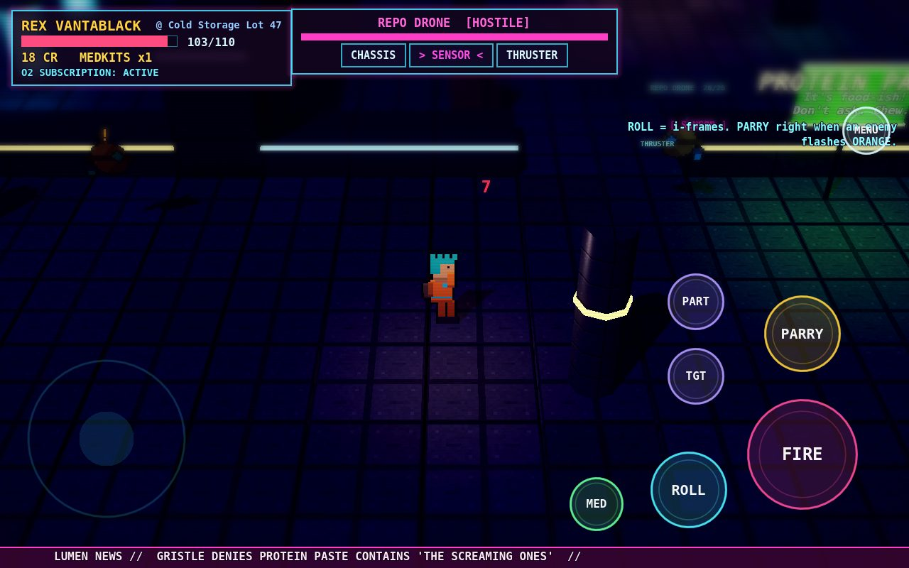
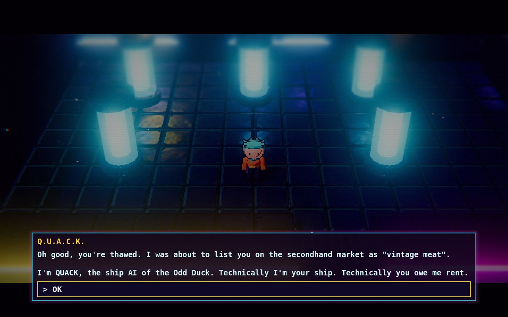
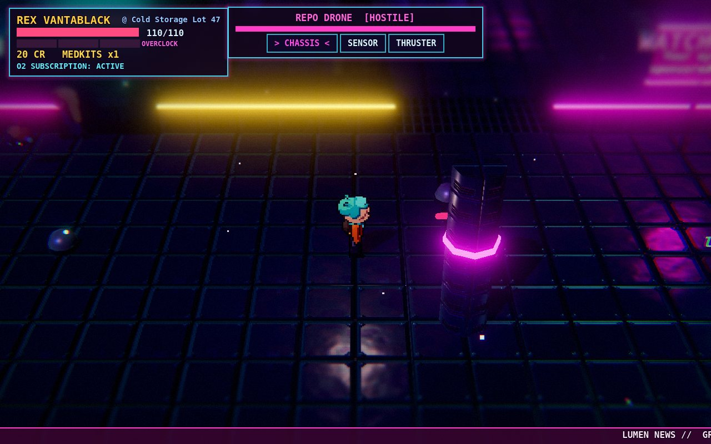
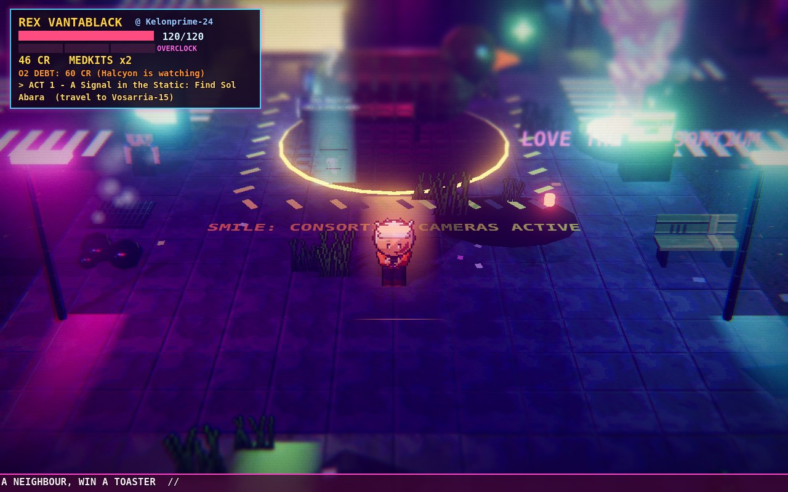
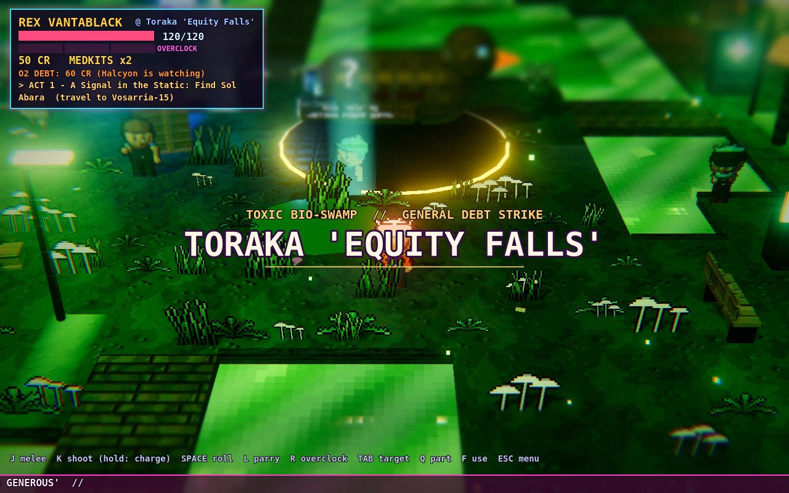
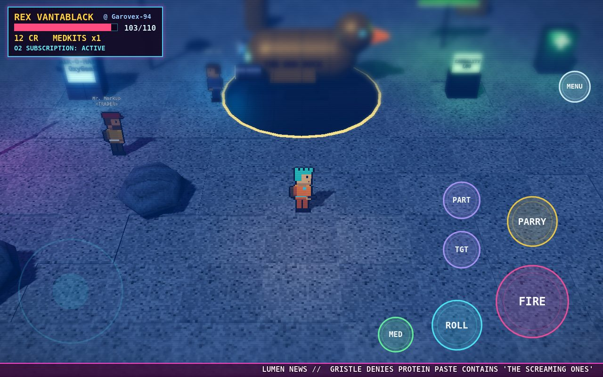
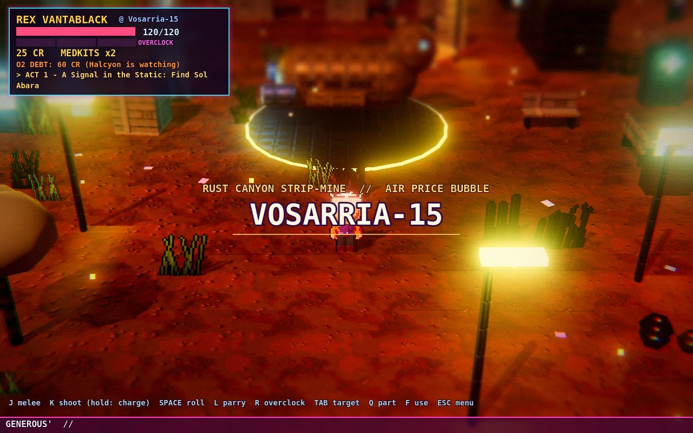
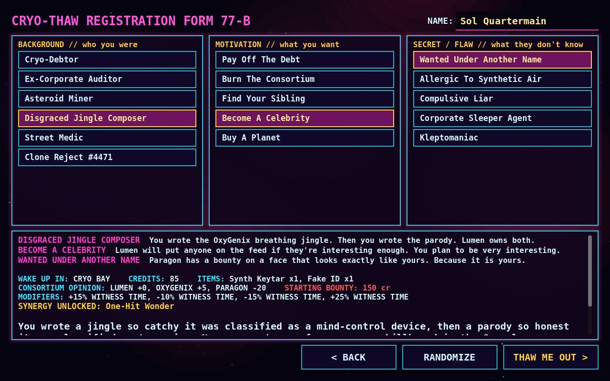
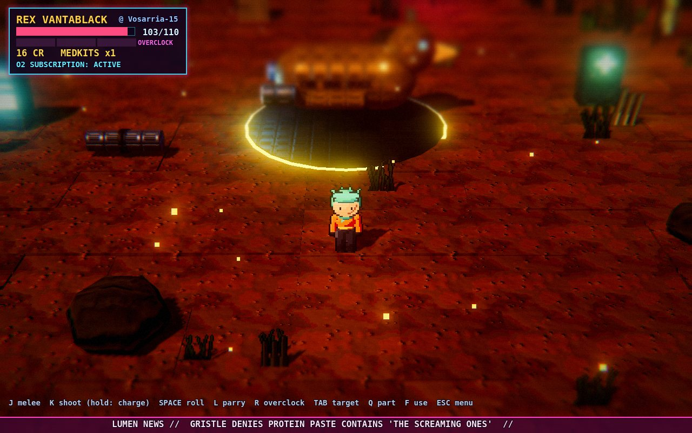

# ODD-SPACE

> **Sci-Fi 2.5D (2D sprites in a 3D diorama) Action-RPG** · Retro-Futurism ยุค 80s/90s · Dark Satire เสียดสีทุนนิยมอวกาศ
> Godot **4.7** (Mobile renderer / Vulkan) · ออกแบบให้พัฒนาและเล่นบน **Samsung Galaxy Tab S12 Ultra** · รองรับ **จอย / จอสัมผัส / คีย์บอร์ด**



ศตวรรษที่ 32 · กลุ่มทุนบิ๊ก 5 **The Consortium** เก็บเงินกับทุกอย่าง แม้แต่อากาศหายใจ
คุณตื่นจากตู้แช่แข็งบนสถานีร้าง *Cold Storage Lot 47* พร้อมยานมือสอง **The Odd Duck**
และ AI ประจำยานปากแจ๋ว **Q.U.A.C.K.**

| | |
|---|---|
|  |  |
|  |  |
|  |  |
|  |  |

---

## ▶ เล่นได้ทันที (Android / Galaxy Tab)

1. เอาไฟล์ `odd-space.apk` มาไว้บนแท็บเล็ต — จากไฟล์ที่ Claude ส่งให้ในแชท, หรือจาก **[หน้า Releases](https://github.com/teelopnee/Odd-Space/releases)** (เมื่อมีการอัปโหลด / เมื่อเปิด auto-build แล้ว)
2. แตะไฟล์เพื่อติดตั้ง (ครั้งแรกให้อนุญาต *ติดตั้งแอปที่ไม่รู้จัก* ให้แอปที่ใช้เปิดไฟล์)
3. เปิดเกม **ODD-SPACE** — ต่อจอย Bluetooth (Xbox / PlayStation / 8BitDo ฯลฯ) ได้เลย ปุ่มสัมผัสจะซ่อนเองเมื่อใช้จอย และกลับมาเมื่อแตะจอ

> ต้องการให้ GitHub สร้าง APK ใหม่อัตโนมัติทุกครั้งที่ push? ดูหัวข้อ *Auto-build APK* ใน [docs/TABLET_WORKFLOW.md](docs/TABLET_WORKFLOW.md)

## 🎮 การควบคุม

| แอ็กชัน | จอย (Xbox / PS) | แท็บเล็ต | คีย์บอร์ด |
|---|---|---|---|
| เดิน / วิ่ง (กดแรง = วิ่ง) | L-Stick | จอยซ้าย | WASD |
| **ฟัน 3 จังหวะ (คอมโบ)** | X / □ | MELEE | J |
| ยิง (แตะ) / **ยิงชาร์จ** (กดค้าง แล้วปล่อย ทะลุศัตรู) | RT / R2 | FIRE | K |
| กลิ้งหลบ (i-frame) — หลบนาทีสุดท้าย = **PERFECT DODGE** สโลว์โม | A / ✕ | ROLL | Space |
| ปัดป้อง — ศัตรูเซ, กระสุนสะท้อนกลับ x2 | RB / R1 | PARRY | L |
| **OVERCLOCK** (ใช้เกจ 3 ช่องที่สะสมจากการตี/ปัด/หลบ) | B / ○ | BOOST | R |
| เปลี่ยนเป้า / เปลี่ยนชิ้นส่วนที่เล็ง | LB / R-Stick ซ้ายขวา · LT / R-Stick ขึ้นลง | TGT / PART / **แตะที่ศัตรู** | Tab / Q |
| คุย / ขโมย / ใช้ | Y / △ | ปุ่มกลางจอ | F |
| เมนู · Causality Log | Start · Back | MENU | Esc · C |
| **ในเมนู/บทสนทนา**: เลื่อน · เลือก · ย้อนกลับ · เปลี่ยนแท็บ | D-Pad/L-Stick · **A** · **B** · LB/RB | แตะ | ลูกศร · Enter · Esc |
| **พุ่งฟัน** (กดฟันตอนศัตรูห่าง 3-9 ม.) · สลับดาบ · สลับปืน | X · L3 · R3 | MELEE · BLADE · GUN | J · 1 · 2 |

## ✨ ใหม่ใน v0.11.0 — การต่อสู้ใหม่: ศัตรูผลัดกันบุก, พุ่งฟัน, อาวุธ 10 ชิ้น, ศัตรู 10 แบบ

- **สู้ง่ายขึ้นและยุติธรรมขึ้น**: ศัตรูผลัดกันโจมตี (ยิงพร้อมกันได้ทีละ 1 ตัว โจมตีพร้อมกันไม่เกิน 2), ศัตรูยิงไกลถอยหนีน้อยลงและช้าลง,
  **ยืนนิ่งรีโหลดหลังยิงทุกชุด** (ช่องให้บุก), กระสุนศัตรูช้าลง, ศัตรูกระจายเป็นหน่วยลาดตระเวน 1-2 ตัวทั่วแผนที่ ไม่กองรวมกัน,
  ตัวที่อยู่ไกลไม่ถูกเรียกมารุมพร้อมกันอีก
- **DASH STRIKE**: กดฟันตอนมีศัตรูห่าง 3-9 เมตร = พุ่งเข้าประชิดทันที (อมตะระหว่างพุ่ง) แล้วต่อคอมโบเลย
- **ศัตรูใหม่ 5 แบบ** (รวม 10): Riot Unit มีโล่กันกระสุนด้านหน้า (อ้อมหลัง/ปัดป้อง/ชาร์จช็อต/ระเบิด/ดาบ/ฉมวกกระชาก),
  Gutter Punk วิ่งเร็วอ้อมข้าง, Ad-Bomb Bot วิ่งมาระเบิด (ยิงมันก่อนให้ระเบิดใส่พวกเดียวกัน!), Ad-Swarm Drone มาเป็นฝูงละ 3,
  Vat Golem ยักษ์ทุบพื้น — แต่ละฝ่ายมีชุดศัตรูของตัวเอง ยิงไกลเป็นส่วนน้อย
- **อาวุธใหม่** — ดาบ/อาวุธประชิด: Lead Pipe, Shock Baton (สตันทุกครั้ง), Chain Whip (ระยะไกล ฟาดกว้าง), Mono-Katana (ทะลุเกราะ/โล่),
  Repo Hammer (หนัก จบคอมโบด้วยคลื่นกระแทก); ปืน: Sidearm (ชาร์จได้), Scatter Cannon (ลูกซอง), Arc Thrower (สายฟ้ากระโดด 3 ตัว + สตัน),
  Repo Harpoon (**กระชากศัตรูเข้ามาหา**), Paste Grenade (ระเบิดวงกว้าง ไม่โดนพลเรือน)
- ได้อาวุธจาก: ร้านพ่อค้าข้างถนน / โรงรับจำนำ / ร้านบริษัท, ศัตรูดรอป, และ **ภูมิหลังตัวละคร** (บอดี้การ์ดเริ่มด้วยค้อน, Repo Agent ได้ฉมวก ฯลฯ)
- สลับอาวุธ: คีย์บอร์ด 1/2, จอย L3/R3, จอสัมผัสปุ่ม BLADE / GUN — HUD บอกอาวุธที่ถืออยู่

## ✨ ใหม่ใน v0.10.0 — ทุกร้านมีเจ้าของตัวจริง

- **เจ้าของร้านยืนอยู่หน้าประตูทุกร้าน** (เมืองหนึ่งมี ~20 ร้าน) มีชื่อ หน้าตา นิสัยของตัวเอง และ **เป็นคนเดิมทุกครั้งที่กลับมา** (บันทึกในเซฟ)
- **ทักตามความสัมพันธ์**: จำสิ่งที่เห็นคุณทำ, ลูกค้าประจำ ("เหมือนเดิมไหม?"), แฟนคลับ, หุ้นส่วนลับ, คนที่กลัวคุณ, คนที่ไม่ชอบคุณ
- **ราคาเปลี่ยนตามความรู้สึก**: เพื่อน/ลูกค้าประจำได้ลด (สูงสุด ~45%), ศัตรูโดนบวก (สูงสุด +60%), คนที่กลัวคุณ "ลดให้พิเศษ"
- **ทุกตัวเลือกในร้าน (ครบ 14 ประเภทร้าน) เจ้าของตอบโต้กลับ**: ซื้อของ -> บัตรสะสมแต้ม/ของใต้เคาน์เตอร์/ให้ทิป;
  เลี้ยงทั้งร้าน -> แก้วหน้าฟรี; ต่อยกันในบาร์ -> "เฟอร์นิเจอร์ฉัน!" จ่ายค่าเสียหายหรือโดน **แบนจากร้าน** + แจ้งความ;
  ขโมยของ -> เจ้าของ **รู้ตัวทีหลัง** แล้วอาจแบนคุณ; ร้องคาราโอเกะดี -> ได้งานประจำทุกคืนวันพฤหัส; ร้องแย่ -> "อย่าทำแบบนี้ในร้านฉันอีก"
- **คุยกับเจ้าของได้ในร้าน**: ต่อราคา, จีบ, ขู่, ใช้ชื่อครอบครัว... (ใช้ระบบตอบโต้เดียวกับ NPC ทั่วไป)
- **โดนแบน**: เข้าร้านไม่ได้จนกว่าจะขอโทษ จ่ายค่าเสียหาย หรือขู่ให้ยอม; **ถ้าเจ้าของตาย** ร้านจะมืดตลอดไป มีรูปและดอกไม้หน้าประตู
  (จะขโมยเงินในลิ้นชัก หรือทิ้งเงินช่วยครอบครัวก็ได้ — ถนนจำ)

## ✨ ใหม่ใน v0.9.0 — NPC ตอบโต้กลับทุกครั้ง

- **ตรวจครบทั้ง 90 การกระทำ × สำเร็จ/ล้มเหลว (155 ผลลัพธ์)**: ทุกผลลัพธ์ทิ้งร่องรอยถาวรไว้ และ **NPC ตอบโต้กลับเสมอ**
  — ยื่นข้อเสนอ, ขอร้อง, ท้าทาย, ถามกลับ — ให้คุณเลือกตอบอีกรอบ (ตัวเลือกตอบโต้ 156 แบบ, เส้นทางสนทนาที่ประกอบได้ ~64 พันล้านแบบ ตาม `tools/count_copy.py`)
- ตัวอย่าง: ขู่สำเร็จ -> "เอาเงินไปเลย!" (รับเงิน / ปล่อยไป / ประจานให้ทั้งถนนกลัว / ให้เป็นสายข่าว); ขู่พลาด -> "ลองดูสิ!" (ถอย / ต่อย / หัวเราะกลบ);
  ล้วงกระเป๋าสำเร็จ -> เขายังไม่รู้... **อีกสักพักจะรู้ตัวว่าโดนขโมย** แล้วอาจหันมาชี้หน้าคุณ (หรือคุณแอบคืนก่อนก็ได้);
  แสดงโชว์สำเร็จ -> ได้ **แฟนคลับ** ที่โห่ร้องทุกครั้งที่เห็นคุณ; แสดงพลาด -> ได้ **คนโห่** ที่เล่าเรื่องขายหน้าคุณให้คนอื่นหัวเราะ;
  ทำข้อตกลงสำเร็จ -> ได้ **หุ้นส่วน** ที่จะเดินมาหาพร้อมดีลลับ (แอร์ถูก, ฝากของ, ขายข่าว); ทำเรื่องแปลก -> คนอยากรู้เดินตามถามไม่หยุด หรือคนขวัญเสียหนีไปเล่าต่อ;
  ให้ทนายของบ้านไล่ -> เลือกได้ว่าจะปล่อยไป, จ่ายค่าชดเชยให้อยู่ต่อ, หรือซ้ำเติม
- **NPC เดินมาหาคุณเอง**: คนที่คุณช่วยมาขอบคุณพร้อมของขวัญ, คนที่สงสารคุณมาดูแล, หุ้นส่วนมาพร้อมดีล, แฟนคลับขอเซลฟี่,
  คนที่แค้นมาเผชิญหน้าก่อนจะโทรแจ้งตำรวจ (จ่าย/ขอโทษ/ขู่/ปล่อยให้โทร), คนที่แอบชอบเขียนกลอนให้

## ✨ ใหม่ใน v0.8.0 — ทุกการกระทำมีผลจริง

- **แก้บั๊กหยุดคนแจ้งตำรวจไม่ได้**: เดิมติดสินบน/ขู่สำเร็จแล้ว NPC ยังค้างสถานะ "กำลังโทร" ตลอด ตอนนี้วางสายจริงและกลับไปใช้ชีวิตปกติ
  ระหว่างที่เขากำลังโทร ลองอะไรก็ได้ (จ่าย, จีบ, ขู่, ใช้เส้นสายครอบครัว) — สำเร็จ = **สายตัด**, พลาด = **พูดเร็วขึ้น** พร้อมบอกว่ายังมีใครโทรอยู่อีก
- **ทุกการกระทำบอกผลชัด ๆ** ท้ายบทสนทนา: ความสัมพันธ์ก่อน -> หลัง, ใครเห็นบ้างและคิดยังไง, ข่าวจะลือไปทั่วดาว
- **ป้ายเหนือหัว + พฤติกรรมเปลี่ยนจริง**: ให้เงิน -> <OWES YOU ONE> คนจนเดินไปต่อคิวซื้อข้าว แล้ว **กลับมาตอบแทน** (เงิน/ยา/ชื่อเสียง/ผู้ติดตาม/ข่าว);
  ให้ทนายของบ้านโทร -> คุกเข่ารับหมายแล้ว **เก็บของออกจากถนนไปเลย**; ยึดของ -> เสื้อผ้าเหลือแต่สีเทา คุกเข่า แล้ว **ไปแจ้งความ Paragon**
  (หยุดได้แบบเดียวกับพยาน); บอกว่าบ้านฉันคือใคร -> โค้งคำนับ เงียบปาก ลดราคา หรือถ้าพลาด -> โกรธแล้วร้องเรียน;
  ขู่/รีดไถ -> <SCARED OF YOU> หลบหน้าตลอด; คนที่ <FURIOUS> ด่าตามหลัง; คนที่ <DEVOTED> **ไม่แจ้งตำรวจเรื่องคุณเลย**
- **ดาวจำคุณ**: คนแปลกหน้าที่เพิ่งเจอบนดาวเดิมทักคุณดี/ร้ายตามเรื่องที่ถนนเล่าต่อกัน ถ้าคุณเคยฆ่าคนกลางถนน คนจะเดินหนี
- ทำดีไม่มีใครโทรแจ้งตำรวจอีกแล้ว (เดิมพยานโทรแจ้ง "การบริจาค") — แจ้งเฉพาะอาชญากรรมและการข่มขู่

## ✨ ใหม่ใน v0.7.0 — ทุกคนมีตา มีความจำ และมีเสียงของตัวเอง

- **NPC เห็นสิ่งที่คุณทำในระยะสายตา** (ช่วยคน, ขู่, ล้วงกระเป๋า, ต่อยตี, ฆ่า, ไว้ชีวิต, ยิงตำรวจ, พังโดรนทวงหนี้, หลบกระสุนสวย ๆ,
  เข้าบาร์/ร้านเงินกู้, เต้นข้างโฮโลแกรม, เดินเลือดโชก) แล้ว **ตอบสนองตามนิสัย** — คนจนเชียร์คุณยิงตำรวจ คนบริษัทขนลุก ศิลปินปรบมือ
  หุ่นยนต์บี๊บ — ความชอบที่มีต่อคุณเปลี่ยนตาม และ **จำไว้** เพื่อทักเรื่องนั้นตอนคุณเดินไปคุย
- **ข่าวลือข้างถนน**: ดาวทั้งดวงเล่าต่อสิ่งที่คุณทำ (บันทึกในเซฟ) คนที่ไม่ได้เห็นก็ "ได้ยินมาว่า..." ถามได้ว่าคนพูดถึงคุณว่าอะไร
- **NPC พูดถึงตัวคุณตามที่คุณสร้าง**: ชนชั้น (ทายาท 5 บริษัท .. ขอทาน), อายุ (บอกอายุจริง), ภูมิหลัง 23 แบบ, นิสัย, เป้าหมาย,
  ความลับ (เฉพาะคนแปลก ๆ ที่ "มองออก"), แผล, เงินในกระเป๋า, หนี้อากาศ, ค่าหัว, ชื่อเสียง, ลูกเรือ, ผู้ติดตาม, วิกฤตของดาว และตัวร้ายในเนื้อเรื่อง
- **เสียงของแต่ละคนต่างกัน**: 8 น้ำเสียง (คนจน, คนงาน, ศิลปิน, คนบริษัท, กบฏ, คนแปลก, พ่อค้า, หุ่นยนต์) × 4 อารมณ์ (อบอุ่น, เฉย, เย็นชา, กลัว)
  + คำติดปากประจำตัว + ชีวิตส่วนตัว (ลูก, สัตว์เลี้ยง, งานอดิเรก, ความกังวล)
- **ตัวเลือกใหม่ที่ปลดล็อกจากสิ่งที่ NPC เห็น**: อธิบายตัว, ยัดเงินปิดปาก, ขอให้เล่าต่อ, สอนท่าหลบ, ขอโทษ, ชวนเต้น, ขอให้ช่วยทำแผล,
  แลกเรื่องสู้กัน, ขอให้ช่วยปิดบัง, ถามว่าคนพูดถึงคุณว่าไง + ทุกการกระทำมีคำพูดตอบกลับต่อท้าย
- **ทุกแท็กที่เลือกมีการกระทำของตัวเอง** (รวม 90 แบบ): ผู้จัดการคุย one-on-one, ฟรีแลนซ์แลกทริกแอป, อดีตผู้ตรวจบัญชีตรวจสัญญาหนี้,
  นักขุดโชว์คริสตัล, โคลนถามว่าเคยเห็นหน้านี้ไหม, คนงานโรงเพสต์เฉลยว่ามีอะไรในเพสต์, ทุกเป้าหมายชีวิต (หางาน, ชวนปฏิวัติ, ขอให้ถ่ายคลิป,
  ถามทางหนีออกจากดาว...), ทุกความลับ (บอกชื่อปลอม, โกหกเรื่องใหญ่, ท่องรหัสสายลับ, คืนของที่ "เก็บได้", ยืมข้อมูลชีวิตคนอื่น...)
- **ขนาดบทพูด**: `python3 tools/count_copy.py` นับได้ ~82 ล้านบรรทัดที่ไม่ซ้ำกัน (เฉพาะคำพูดเกี่ยวกับตัวคุณ ~57 ล้าน,
  ปฏิกิริยาเมื่อเห็นคุณทำอะไร ~390,000) จากชิ้นส่วนที่เขียนเอง ~2,000 ชิ้น และไม่พูดประโยคเดิมซ้ำติดกัน

## ✨ ใหม่ใน v0.6.0 — Voices: โลกเขียนบทพูดของตัวเอง

- **แก้จอย**: ต่อจอยแล้วกด A เลือก / B ย้อนกลับ ได้ทุกเมนู ทุกบทสนทนา ทุกร้าน (มีสคริปต์ทดสอบส่งปุ่มจอยจริง `tools/pad_test.gd`)
- **นักเขียนโฆษณาอัตโนมัติ** (`data/copy.json` — 130 สัญลักษณ์, ~1,100 ทางเลือก ประกอบกันได้หลายล้านแบบ): ป้ายโฆษณา, สโลแกนโฮโลแกรม,
  ชื่อร้าน/แผง/ถนน, ข่าววิ่ง, ใบปลิวบนกำแพง (ห้องเช่า, วงดนตรี, หาของหาย, ลัทธิ, ประท้วง), กราฟฟิตี้, เมนูอาหาร, ประกาศเสียงตามสาย,
  **วิทยุข้างถนน** (ดีเจ, เพลงขอ, ชาร์ตเพลง, รายงานจราจร), ชื่อ NPC/หุ่นยนต์/พ่อค้า, ป้ายโดรนขายของ, หน้าจอตาย และสปอนเซอร์หน้า Title
- **NPC คุยกันจริง**: บทสนทนา 2 คนผลัดกันพูด (`"A -- B -- C"`), คนข้าง ๆ ตอบกลับ, คุยเรื่องรายการทีวี ทีมกีฬา อาหาร ราคาอากาศที่สุ่มใหม่ทุกครั้ง
- **ศัตรูพูดระหว่างสู้**: ตำรวจ Paragon อ้างกฎหมายประหลาด, โดรนทวงหนี้อ่านยอดหนี้, นักทวงหนี้ขู่เรื่องดอกเบี้ย, โจรสลัด, หนอนเพสต์ (ตอนโดนตี / ยอมแพ้ / ถอย)
- **ทุกร้านทักทายไม่ซ้ำ**: ฉาก + คำพูดเจ้าของร้านสุ่มประกอบกันทั้ง 14 ประเภท, คุยเล่นกับ NPC ดึงเรื่องจากโลกจริงของเกม
- บทพูดประจำที่เพิ่มอีก ~200 บรรทัด (วิกฤตแต่ละดาว, ปฏิกิริยาต่อฐานะ/อายุ/ชื่อเสียงคุณ, แต่ละไบโอม), เสียง QUACK บนยานเพิ่มเป็น 3-14 แบบต่อเหตุการณ์
- ภาพ: กล้องตัดตึกทั้งแถวที่บังตัวละคร, คลองในเมืองสะท้อนแสงนีออน, ป้ายโฮโลแกรมตัดบรรทัด

## ✨ ใหม่ใน v0.5.0 — โลกที่มีชีวิตและสวยตาแตก

**โลกไม่กลวงอีกต่อไป**
- **ทุกป้ายร้านเข้าได้จริง** 14 ประเภท: บาร์, คาราโอเกะ, ตู้เกม, คลินิกเถื่อน, โรงรับจำนำ, โมเต็ลแคปซูล, ร้านเงินกู้, ร้านสัก, ร้านเทป, ตู้ขายอากาศ, ร้านฝังอุปกรณ์ไซเบอร์, หมอดู, ร้านของบริษัท, แผงอาหาร — ตัวเลือกรวม 59 แบบที่เปลี่ยนตามตัวละคร (สักลาย/ฝังชิปเพิ่มค่าสถานะถาวร, นอนพัก + เซฟ, พนัน, หาลูกเรือ, หมอดูใบ้เนื้อเรื่อง)
- **โลกพูดถึงคุณ**: ป้ายโฆษณาขึ้นข่าวที่คุณก่อ / ขึ้นหน้าคุณเมื่อดัง, **โปสเตอร์จับตาย** มีชื่อและค่าหัวคุณ, คนในเมืองพูดถึงชื่อเสียง ค่าหัว ฐานะ อายุ และสิ่งที่คุณทำกับดาวนี้
- **ชีวิตประจำวันของ NPC**: นั่งม้านั่ง, ก้มเล่นมือถือ, ต่อคิวซื้ออาหาร, เต้นรอบโฮโลแกรมยักษ์, โบกมือทักเมื่อชอบคุณ, เชียร์เมื่อคุณทำดี
- **รถวิ่งบนถนนในเมือง** (เบรกให้คนข้าม) + รถบินผ่านเฟรม

**ภาพและแอนิเมชันใหม่**
- ท่าทางใหม่ 6 ท่าทุกตัวละคร: นั่ง, เล่นมือถือ, เต้น, เชียร์, โบกมือ, **คุกเข่ายอมแพ้** (บอสยอมจำนนแบบมีท่าทาง)
- **โฮโลแกรมคนยักษ์เต้นกลางลานเมือง** ข้างลานจอดยาน (สแกนไลน์ กะพริบ เปลี่ยนช่อง หมุนโชว์รอบตัว) + ลานจอดมีเส้นทาสีเตือน ไฟสัญญาณกะพริบ และข้อความประชดบนพื้น
- ถนนเปียกสะท้อนแสงนีออนทุกดวง, ท่อนีออนตามขอบตึก, สายไฟห้อยโคมข้ามถนน, เส้นถนน/ทางม้าลาย/ฝาท่อมีไอน้ำ, ขยะ คราบน้ำมัน
- ฝนกระเซ็นบนพื้น + ฟ้าผ่าแลบทั้งฉาก + เสียงฟ้าร้อง, ป้ายไฟเสียกะพริบ, หมอกลอยบนหนอง, ลมหมุนฝุ่นในทะเลทราย/หุบเขา, ใบบัวลอยน้ำ
- **เพลงใหม่ประจำทุกไบโอม** 5 เพลง

## ✨ ใหม่ใน v0.4.0 — Life Paths: ไม่มีใครเล่นแล้วได้เรื่องเดียวกัน

**สร้างตัวละครได้ 6 หมวด (รวมกันได้ 2.2 ล้านแบบ × จุดเริ่มต้น 8 แบบ)**
- **ฐานะ** 14 แบบ: ทายาทบริษัททั้ง 5 แห่ง (Paragon / Halcyon / Gristle / OxyGenix / Lumen), ตระกูลเงินเก่า, ผู้บริหาร, หัวหน้างานระดับกลาง, ไรเดอร์, คนจนทำงาน, หนี้ท่วมหัว, **ขอทาน**, **ทรัพย์สินค้ำประกัน (มีคนเป็นเจ้าของ)**, คนไร้ตัวตนนอกระบบ
- **อายุ** 6 ช่วง + เลือกอายุจริงได้ด้วยสไลเดอร์ (16 จนถึง 312 ปีสำหรับ "มนุษย์แช่แข็งยุคก่อน")
- อาชีพเดิม 23 แบบ · นิสัย 8 แบบ · เป้าหมาย 12 แบบ · ความลับ 12 แบบ · คอมโบพิเศษ 31 แบบ

**การกระทำต่างกันตามตัวที่เลือก (54 แบบ)**: ทายาท "รู้ไหมว่าครอบครัวฉันเป็นใคร" / เรียกทนายประจำตระกูล, ขอทานขอเงิน / แลกข่าวลือ, เด็กแกล้งทำไร้เดียงสา, คนแก่ขอส่วนลดผู้สูงอายุ / เล่าเรื่องสมัยก่อน, แฮกเกอร์เจาะข้อมือ, นักเทศน์ชวนเข้าลัทธิ, คนจัดตั้งสหภาพ, คนเจ้าเสน่ห์, คนโหดรีดไถ ฯลฯ — โอกาสสำเร็จขึ้นกับนิสัย ฝ่าย และอารมณ์ของ NPC ทุกการกระทำถูกโลกจดจำ

**เนื้อเรื่องแตกแขนงทุกจุด**: ทุกบทมีทางเลือก, หัวหน้าศัตรูยอมแพ้ได้ (ฆ่า / ปล่อย / จับส่ง / ชวนเข้าพวก / สอบสวน / ไลฟ์สารภาพ / ยึดทรัพย์ / ให้ชดใช้ / กลับใจ), หักมุม 8 แบบ (รวมถึงแปรพักตร์ไปอยู่ฝ่ายตัวร้าย), ตอนจบหลัก 15 แบบ + 5 แบบสำหรับคนทรยศ, และ **จบก่อนกำหนด** ได้เมื่อเป้าหมายชีวิตสำเร็จ
**ฉากจบประกอบจากทุกการตัดสินใจ: 3,132,168 แบบที่ไม่ซ้ำกัน** (นับจริงด้วย `tools/count_endings.gd`)

**ทุกดาวมีเรื่องของตัวเอง**: วิกฤตของดาวกลายเป็นเรื่องท้องถิ่นที่มีตัวละครฝั่งประชาชนกับฝั่งบริษัท จบได้ 5 แบบ และเปลี่ยนดาวนั้นถาวร (วิกฤตหาย / แย่ลง / ราคา / ค่าอากาศ / ปลดแอกดาว) · **เหตุการณ์ข้างถนน** 16 แบบ เช่น ปล้น, ยึดขาเทียม, ไล่ที่, ประมูลคนแช่แข็ง — ทางเลือกรวม 69 แบบ

## ✨ ใหม่ใน v0.3.0 — ทุกการผจญภัยไม่ซ้ำกัน

**เริ่มเกมแบบที่คุณเลือก**
- เลือก **จุดเริ่มต้น**: ตื่นจากตู้แช่แข็งใน Lot 47 (แบบคลาสสิก) หรือเป็น **คนพื้นเมืองของดาวดวงไหนก็ได้** ในจักรวาลนั้น (คนในพื้นที่รู้จักคุณ +ชื่อเสียงกับเจ้าของดาว +เงินติดตัว และข้ามบทเปิดไปเลย)
- **Universe #** (seed): ทุกจักรวาลมีดาว 7 ดวง ตัวละคร และเนื้อเรื่องของตัวเอง — พิมพ์เลขเดียวกันเพื่อแชร์จักรวาลให้เพื่อน หรือกด *NEW UNIVERSE*
- **ปรับแต่งหน้าตา**: 36 สไตล์ (ทรงผม/ชุด/รูปร่าง/อุปกรณ์) + สีผิว ผม ตา ชุด และนีออน ดูตัวอย่างหมุน 8 ทิศแบบสด ๆ หรือกด *RANDOM*

**ตัวละครสุ่มแบบ chibi pixel art**
- *Sprite Forge v2*: ตัวละครสัดส่วน chibi หัวโต 64x64 แบบ palette-indexed → ร่างเดียวใส่สีได้ไม่จำกัด
- NPC ศัตรู ลูกเรือ และตัวละครในเนื้อเรื่องทุกตัวสุ่มหน้าตาเอง (ยูนิฟอร์มตามบริษัท, พังก์, คนงาน, หุ่นยนต์, โดรน, แมลง)

**เนื้อเรื่องสุ่ม (Saga)** — ไม่มีใครได้เรื่องเดียวกัน
- ทุกจักรวาลสุ่ม *ตัวร้าย* (ตำแหน่งบริษัทสุดเพี้ยน + แผนชั่ว), *พันธมิตร*, *มือขวาตัวร้าย*, *ของสำคัญ (MacGuffin)* และ *เส้นเรื่องส่วนตัว* ตาม Motivation ของคุณ (ตามหาพี่น้อง, ล้างหนี้, เผาบริษัท, ดัง, ซื้อดาว)
- 7 บท 3 องก์ กระจายไปทั่วดาว · **จุดหักมุม** มาจาก Secret ของคุณ · ตัดสินใจเลือก 3 ทาง · 3 ตอนจบ
- ภารกิจรองในแต่ละดาว (ค่าหัว, ตามหาของ, ทุบป้ายโฆษณา) · สมุดบันทึก *Journal* ในเมนู · เครื่องหมาย ! ? X บนหัวเป้าหมาย

**โลกหนาแน่น สุ่มใหม่ทุกดาว**
- แต่ละไบโอมมีอัลกอริทึมสร้างแผนที่ของตัวเอง + ขนาดแผนที่สุ่ม:
  เมืองนีออน (ถนนเป็นตาราง ตึกสูงมีกันสาด/ป้ายนีออนแนวตั้ง/แอร์/ระเบียง, ตลาด, ลานกว้าง, รถลอยจอด, สายไฟห้อยโคมระหว่างตึก, รถบินบนฟ้า, ฝูงชน) ·
  หนองพิษ (คลองเรืองแสง + สะพานไม้) · ทะเลทรายโฆษณา (ธารน้ำแข็งพลาสติก + ป้ายยักษ์พัง) · หุบเขาสนิม (เมซ่า + แท่นขุด) · ดวงจันทร์คริสตัล (บ่อเรืองแสง + โดม)
- นอกเมือง: มีหมู่บ้านเล็ก ๆ รอบลานจอดยาน (แผงขายของ, ม้านั่ง, โคมไฟ, ชาวบ้าน)
- สีสัน หมอก แสงอาทิตย์ และสภาพอากาศเปลี่ยนตาม seed ของดาว — ไบโอมเดียวกันก็ไม่เหมือนกัน

## ✨ จาก v0.2.0

**ภาพแบบ 2.5D (สไตล์เดียวกับ classic diorama JRPGs แต่เป็นงานออริจินัลทั้งหมด)**
- ตัวละคร pixel art **8 ทิศทาง** + แอนิเมชันลื่น (เดิน/วิ่ง/กลิ้ง/คอมโบ 3 ท่า/ยิง/ชาร์จ/ปัด/บาดเจ็บ/ล้ม/คุย) สร้างด้วย *Sprite Forge* (โมเดล 3D → ลงสีแบบ pixel art อัตโนมัติ)
- ฉาก 3D พร้อม **normal map** แสงนีออน/โคมไฟสะท้อนพื้นผิว, หน้าต่างมองเห็นเนบิวลา, ลำแสงฝุ่น, ฝุ่นลอย, พื้นสะท้อนแสง, หญ้า/พืชต่างดาวพลิ้วตามลม, ฝน/หิมะ/สปอร์/ประกายไฟ
- เลนส์แบบ 2.5D: **tilt-shift**, bloom ฟุ้ง, vignette, chromatic aberration, grain, color grading
- **คัตซีน**: แถบ letterbox, การ์ดชื่อฉาก (Chapter card), ยานลงจอดทุกครั้งที่ถึงดาวใหม่ — ฉากต่อฉาก

**การต่อสู้มันส์ ๆ**
- คอมโบฟัน + พุ่งเข้าใส่, hitstop, กล้องสั่น/ซูมกระแทก, จอยสั่น, ตัวเลขดาเมจเด้ง
- **BREAK**: ศัตรูมีโล่ + จุดอ่อน (เช่น MEL / BLS / LEG / JET) — ตีจุดอ่อนจนโล่แตก = มึน + ดาเมจ x2
- **Subsystem Targeting**: ยิงขาให้ล้ม, ยิงเจ็ตแพ็กให้ระเบิดใส่พวกเดียวกัน, ยิงอาวุธให้หลุด
- ศัตรูวิ่งวน (strafe) ยิงจากระยะ, ศัตรูประชิดมีวงเตือนบนพื้นก่อนพุ่ง, ตายแล้วเหรียญเด้งเข้าหาตัว

**โลกมีชีวิต**: NPC พูดลอย ๆ (speech bubble), คุยกันเอง, หันมามองเรา, วิ่งหนีเวลามีการต่อสู้, หุ่นยนต์ทำความสะอาด, โดรนโฆษณาบินพร้อมไฟส่อง, ยานบินผ่านนอกหน้าต่าง, เสียงบรรยากาศ

**ระบบหลักเดิม**: Tag Engine · Causality Graph (พยานวิทยุแจ้ง, ฆ่า/ติดสินบน/ขู่ก่อนแจ้งเสร็จ = ข่าวไม่แพร่) · ดาวสุ่ม 4 ชั้น · เหตุการณ์อวกาศ · ชื่อเสียง 5 บริษัท · ลูกเรือทรยศได้ · Flaw & Perk · ค่าอากาศหายใจ

## เปิดโปรเจกต์ (พัฒนาต่อ)
- แท็บเล็ต: Godot Engine 4.7+ (Android) → Import โฟลเดอร์ repo — ขั้นตอนเต็ม: **[docs/TABLET_WORKFLOW.md](docs/TABLET_WORKFLOW.md)**
- PC: `git clone https://github.com/teelopnee/Odd-Space.git` แล้วเปิดด้วย Godot 4.7+

## โครงสร้าง
```
data/            ออกแบบเกมด้วย JSON (ศัตรู, แท็ก, ดาว, เหตุการณ์, ลูกเรือ, บทพูด NPC ...)
src/autoload/    ระบบหลัก: Game, Causality, Factions, Origin, Crew, FlawPerk, Encounters, Saga (เนื้อเรื่องแตกแขนง), Stories (เรื่องประจำดาว + เหตุการณ์ข้างถนน), Interactions (การกระทำตามตัวละคร), ShipAI, Audio, Router
src/actors/      Player, Enemy (BREAK/subsystems), NPC, Projectile, Pickup, BillboardSprite (8 ทิศ, palette-indexed)
src/core/        CharacterLook (สุ่มหน้าตาตัวละคร), PlanetGenerator, FX
src/world/       LevelBuilder (ASCII → ฉาก 3D), WorldGen (สุ่มแผนที่ตามไบโอม), Level, Station (คัตซีนเปิดเกม), Planet (ลงจอด), CameraRig, Critter
src/ui/          HUD, ปุ่มสัมผัส, เมนู, สร้างตัวละคร, แผนที่ดาว
tools/           sprite_forge.py · gen_textures.py · gen_fx.py · gen_audio.py · ตรวจโปรเจกต์/ถ่ายภาพอัตโนมัติ
```
แก้ด่านสถานีได้ที่ตัวอักษรใน `LAYOUT` ของ `src/world/station_prologue.gd` (สัญลักษณ์อธิบายใน `src/world/level_builder.gd`)
ดูแผนที่ดาวที่สุ่มได้เป็นตัวอักษร: `godot --headless --path . --script res://tools/print_world.gd -- all 1234` · เนื้อเรื่องแก้ได้ใน `data/saga.json` · การกระทำ `data/interactions.json` · เรื่องประจำดาว `data/stories.json` · นับฉากจบ: `tools/count_endings.gd`

เอกสาร: [GDD](docs/GDD.md) · [Architecture](docs/ARCHITECTURE.md) · [Tablet workflow](docs/TABLET_WORKFLOW.md)
